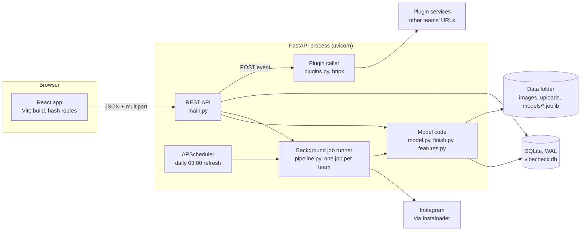
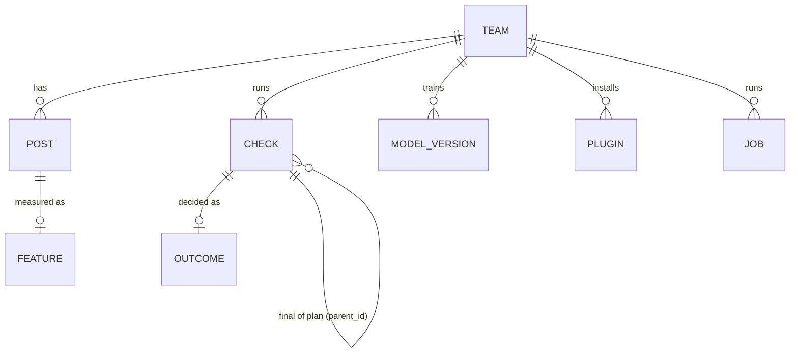
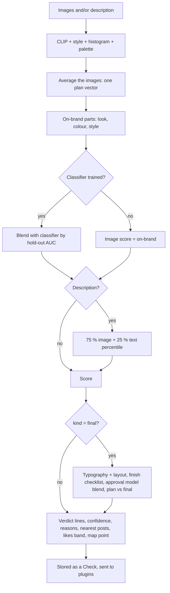

# How VibeCheck works

The complete technical reference for the demo: every pipeline, algorithm, library and number, and why each choice
was made. Written against the code at model **v9** (13 Nov 2026). File references point into this repo.

> **How to use this for the demo.** Sections 1-3 are the 2-minute story. Sections 4-10 are what to open when someone
> asks "how exactly does X work?". Section 11 has every evaluation number and how it was measured. Section 14 is a
> bank of likely cross-questions with short answers. Section 15 is a glossary.

---

## 1. The product in one paragraph

A design team (a club or fest team that posts on Instagram) has a house style that new designers have to absorb by
trial and error: they make a poster, seniors reject it, they try again. **VibeCheck learns the team's style from its
own posts and tells a designer how well an idea or a finished poster fits it, with reasons**, before seniors spend
time on it.

**Seniors:** the team members who review and approve designs before they are posted. In a company this would be the
brand or design lead.

Two checks:

| Check | Input | Output |
|---|---|---|
| **Check my idea** (`kind=plan`) | 1-5 inspiration images and/or a written description | 0-100 on-brand score, verdict (On-brand / Borderline / Off-brand), reasons, the team's 3 closest past posts, palette comparison, expected likes band, position on the style map |
| **Check my design** (`kind=final`) | the finished poster (1 image) | everything above, plus a finish checklist (legibility, text size, resolution, shape), "plan vs final" if linked to an idea check, and the learned **approval model** once the team has recorded enough senior decisions |

When the seniors decide on a design, the team records it (approved / rejected / posted). That design becomes
training data for the approval model, so the tool gets better at predicting *this team's* seniors over time.

**What it is not:** it does not generate designs, it does not judge "good design" in general, and it never
claims to know what the seniors will say until it has learned from their decisions and passed its own tests.

---

## 2. Architecture



- **One process.** The FastAPI app serves the API, the built React app (`frontend/dist`) and the images
  (`/media/...` mapped to the data folder). Long work (import, feature extraction, training) runs in background
  threads inside the same process; the browser polls `GET /jobs/{id}` for progress.
- **Storage.** SQLite with WAL journaling (`db.py`) for rows; files on disk for images and trained models. Every
  path is relative to `VIBE_DATA_DIR`, so a whole team set-up is one folder (`data/`, `data_demo/`, `data_test/`).
- **Models are files.** Each training run writes `models/team_<id>_v<n>.joblib` (a Python dict with every fitted
  piece) and a `ModelVersion` row with its metrics. Scoring loads the newest one and caches it in memory.
- **Configuration** (`config.py`), all environment variables: `VIBE_DATA_DIR`, `VIBE_DB_URL`, `VIBE_CLIP_MODEL`
  (default `ViT-B-32`), `VIBE_CLIP_PRETRAINED` (`openai`), `VIBE_CLIP_FRAMING` (`pad`), `VIBE_SCHEDULER` (1/0),
  `VIBE_REFRESH_HOUR` (3), `VIBE_IG_SESSION_USER`, `VIBE_FAKE_CLIP` (tests), `VIBE_OCR=0` (skip EasyOCR).

### Repository map

| Path | What it is |
|---|---|
| `backend/vibe/main.py` | FastAPI app: every endpoint, scheduler start-up, static files |
| `backend/vibe/db.py` | SQLAlchemy tables, SQLite pragmas, additive schema migration |
| `backend/vibe/schemas.py` | Pydantic request models and the plugin `Panel` contract |
| `backend/vibe/importers.py` | Extract: Instagram download, folder import, single uploads |
| `backend/vibe/pipeline.py` | Transform + load: features, near-misses, backfills, the job runner |
| `backend/vibe/features.py` | CLIP embeddings, zero-shot features, pixel style features, palette, colour histogram, appeal |
| `backend/vibe/finish.py` | Text detection, typography, layout / typeface / clutter measures, finish checklist |
| `backend/vibe/augment.py` | Near-miss generator (8 deliberate mistakes) |
| `backend/vibe/model.py` | Training and scoring: on-brand scorer, calibration, classifier, approval model, likes model, text, map |
| `backend/vibe/plugins.py` | Calling plugins and validating their panels |
| `backend/tests/` | 32 pytest tests (fake CLIP, generated posters) |
| `frontend/src/` | React pages (`pages/`), shared UI (`components/`), API client (`api.js`), styles |
| `plugins/contrast_checker/` | Example plugin: a separate FastAPI service |
| `scripts/` | Evaluation, synthetic data, docs and font tools (section 11) |
| `models_pretrained/` | LAION aesthetic predictor weights (512 numbers + bias) |
| `docs/api.html` | Generated API reference (from the OpenAPI spec) |

---

## 3. The data model



| Table | Key columns | Notes |
|---|---|---|
| `teams` | name, instagram_handle, other_pages_json | other pages = handles of similar pages, used as "not us" examples |
| `posts` | **label**, source_page, external_id, image_path, caption, posted_at, likes, comments, **decision**, **project** | label is `team`, `other`, `rejected` or `augmented` (near-miss). decision is `accepted` / `rejected` / empty. project groups versions of one brief. Unique on (team, source_page, external_id), so re-imports skip known posts |
| `features` | clip (512 float32 bytes), 8 style floats, palette_json, hist (64 float32), aesthetic, typo_json, clip_ver | one row per post. `clip_ver` records how the vector was made so mismatched ones are re-embedded |
| `checks` | kind (plan/final), score, verdict, result_json, inspo_json, model_version, parent_id, project, user | the full result is stored, so History shows exactly what the designer saw |
| `outcomes` | result (approved / rejected / posted), final_image_path | what the seniors decided about a check |
| `model_versions` | metrics_json, file_path, trained_at | every training run, with its evaluation numbers |
| `plugins` | name, url, slot (result / profile), team_id (null = all teams), enabled | |
| `jobs` | kind, status, progress (0-1), message | background work, polled by the UI |

**Migrations.** `init_db()` creates tables and adds any column listed in `_ADDED_COLUMNS` that an older database
lacks (`ALTER TABLE ... ADD COLUMN`); `pipeline.backfill_features` then fills the new columns. So an old data folder
keeps working after an upgrade.

---

## 4. Getting data in (Extract)

Three ways in, all ending as `Post` rows plus an image file under `images/team_<id>/<label>/...`:

### 4.1 Instagram (`importers.fetch_instagram`)
- Uses **Instaloader** to download a public profile into `raw/<handle>/` (images, video thumbnails, compressed JSON
  metadata; no videos, comments or geotags), then imports that folder.
- **Login is the user's job**: Instagram blocks anonymous scraping, so a person runs `instaloader --login <user>`
  once and sets `VIBE_IG_SESSION_USER`. The app never handles passwords.
- `max_posts` caps the download (300 for the team page, 60 per other page by default). With `since`, it stops after
  the 4th post older than the date (posts come newest first, but up to 3 pinned posts can be old).
- **Daily refresh** (`main._daily_refresh`, APScheduler cron at `VIBE_REFRESH_HOUR`, default 03:00): for teams with
  a handle, fetch only the team page's posts from the last 7 days (max 50, other pages skipped), then retrain.

### 4.2 Folder import (`importers.import_folder`)
- Walks a folder for `.jpg .jpeg .png .webp .bmp`. Reads Instaloader's `*.json.xz` sidecars (likes, comments,
  caption, timestamp, shortcode) or a `meta.csv` (`filename, caption, posted_at, likes, comments`).
- **Carousels:** Instaloader names slides `..._UTC_1.jpg`, `..._UTC_2.jpg`; only slide 1 is kept (the cover is
  what the feed shows; later slides are often text pages that would distort the style).
- Dates fall back to the timestamp in Instaloader file names (`2026-03-14_18-00-00_UTC`).

### 4.3 Uploads (`POST /teams/{id}/import/upload`, `importers.add_upload`)
- Many images at once with a label: `team`, `other`, `accepted` (stored as a team post with decision accepted) or
  `rejected` (decision rejected). Optional `project` and an optional `meta.csv` (filename + any of posted_at,
  likes, caption, project; a project in the file overrides the form).
- **De-duplication by content:** the file name is the first 16 hex characters of the image's SHA-1, so the same
  image uploaded twice is one post (a second upload can update its label, decision and project).
- Limits: 15 MB per image; images are EXIF-rotated and flattened onto white if they have transparency.

### 4.4 Decisions as data (`POST /checks/{id}/outcome`)
Marking a **final** check approved / posted / rejected stores that exact image as a post with
`decision=accepted` (label team) or `decision=rejected`, under the check's project. That is how the approval model
gets new training data from normal use.

---

## 5. The pipeline (Transform + Load) and the job runner

`pipeline.run_refresh` is one complete ETL + training run. The UI shows its progress bar from these stages:

| Progress | Step | Function |
|---|---|---|
| 0-35 % | import folders, download Instagram pages (one page failing does not stop the run) | `importers.*` |
| 35-70 % | features for every post without them (batches of 32) | `compute_missing_features` |
| 70-73 % | one near-miss copy of each team post | `make_near_misses` |
| 73-78 % | features for the new near-misses | `compute_missing_features` |
| 76-78 % | re-embed posts whose CLIP vector was made by another set-up | `reembed_outdated` |
| 78-85 % | fill features added in later versions (histogram, appeal, typography, layout) | `backfill_features` |
| 85-100 % | train the model | `model.train` |

The job message ends with a summary, for example: *"model v10 trained (classifier + on-brand), approval model on
(AUC 0.819), hold-out AUC 1.0, 13/65 rejected drafts below the on-brand line"*.

### One job per team (`pipeline.request_refresh`)
Two training runs of one team at once would compute the same features twice and race on the model version number.
So each team runs at most one job. A request that arrives during a run **joins** it. If the request brings
something new (more uploads, an Instagram fetch), exactly **one follow-up run** is queued to start afterwards.
Pressing Retrain during a run just joins it (`follow_up=False`). State lives in two dicts guarded by a lock
(`_active`: team → running job, `_pending`: team → arguments of the single follow-up). The UI disables Retrain while
a job runs.

---

## 6. Features: turning an image into numbers

Every image gets the following, stored in the `features` table (`features.extract`, `finish.typography_full`).

### 6.1 CLIP embedding (512 numbers): "what it looks and feels like"
- **Model:** OpenAI's CLIP **ViT-B/32** through **open_clip** (`open_clip.create_model_and_transforms("ViT-B-32",
  pretrained="openai")`), CPU, PyTorch, no gradients. Output L2-normalised, so the dot product of two vectors is
  their cosine similarity.
- **CLIP** was trained on 400 million image-caption pairs to put an image and its caption close together. Its image
  vectors capture subject, composition, colour mood and genre, and text lives in the same space, which is what lets a
  written description be compared with posters.
- **Whole-poster framing (v5):** CLIP's standard preprocessing resizes the short side to 224 px and centre-crops,
  which cuts about 10 % off the top and bottom of a 4:5 poster, exactly where titles, dates and logos are.
  `pad_square` pads the image to a square with its own median edge colour first. Measured: rejected drafts caught at
  a 10 % false-alarm rate went from 42 % to 64 % with no loss elsewhere.
- **Why not a bigger model?** Tested on the real data (`scripts/embed_variants.py` + `scripts/evaluate.py`):
  ViT-B/32 0.90 time-forward AUC, ViT-B/16 0.86, ViT-L/14 0.79, DINOv2 0.17-0.44. Bigger and self-supervised models
  focus on *what* is in a poster (objects, faces) rather than its *style*, so they rank worse here, and they are
  3x slower.
- **Versioning:** `EMBED_VERSION = "ViT-B-32/openai/pad"` is stored with every vector; if the set-up changes, older
  vectors are recomputed on the next run so all vectors in a team are comparable.

### 6.2 Eight readable style features (each 0-1)

| Feature | How it is computed (`features.style_features`, image shrunk to 384 px) |
|---|---|
| brightness | mean HSV value (V channel) / 255 |
| saturation | mean HSV saturation / 255 |
| warmth | 0.5 + (mean red - mean blue), clipped to 0-1 |
| busyness | share of Canny edge pixels (thresholds 80/160) x 5, clipped (20 % edges = 1) |
| whitespace (empty space) | share of 16x16 tiles whose grey-level standard deviation is below 6 (nearly flat) |
| contrast | RMS contrast: grey standard deviation / 128 x 1.5, clipped |
| text_amount | **CLIP zero-shot**: similarity to "a poster covered in lots of text..." vs "an image with almost no text" |
| illustration | **CLIP zero-shot**: "a flat graphic illustration / vector artwork / cartoon" vs "a real photograph" |

**Zero-shot formula:** with p and n the averaged, normalised text vectors of the two prompt groups and v the image
vector, `logit = 100 x (v·p - v·n)` (CLIP's own temperature), `feature = sigmoid(logit / 2)`.

The six pixel features (all except the two zero-shot ones) also feed the **style match** signal (7.1).

### 6.3 Palette (5 colours)
OpenCV **k-means** (k = 5, k-means++ init, 3 attempts, fixed seed) on the pixels of a 64x64 thumbnail; each cluster
centre becomes a hex colour with its share of pixels. Used for the palette comparison and the plugins.

### 6.4 Colour histogram (64 numbers)
The image (96x120) in **CIE Lab** colour space, counted into 4x4x4 bins and normalised to sum to 1. Lab is used
because distances in it roughly match perceived colour difference. This captures *which colours in what amounts*,
which CLIP largely ignores. Compared with a **chi-square distance**: `sum((H - h)^2 / (H + h))`.

### 6.5 Audience appeal (LAION aesthetic score)
The **LAION aesthetic predictor** for CLIP ViT-B/32: a single linear layer (512 → 1) trained on human ratings of
general visual appeal (about 1-10). Stored per image. **It is never used for the on-brand verdict**: on the real
data it rated the team's rejected drafts *higher* than the accepted posters (it likes ornate, "artsy" drafts). It is
shown as "audience appeal" (percentile among the team's posts), feeds the likes model, and is one input of the
approval model, where the team's decisions decide how much it counts.

### 6.6 Typography (`finish.typography`)
- **Text detection:** **EasyOCR's CRAFT detector**, detection only (`recognizer=False`). We need *where* text is,
  not what it says. Runs at 540 px width. If EasyOCR is missing (tests), a fallback finds text-like regions with
  morphological gradient + Otsu threshold + horizontal closing + connected components.
- From the boxes (all normalised to image size):

| Measure | Definition |
|---|---|
| text_area | summed area of text boxes (share of the image) |
| n_lines | number of boxes / 40 |
| headline | height of the tallest box (share of image height) |
| smallest | height of the shortest box |
| contrasts | **WCAG contrast** of each box: pixels split into light and dark with Otsu, ratio `(L_light + 0.05) / (L_dark + 0.05)` using WCAG relative luminance |
| min_contrast | lowest box contrast |
| edge_margin | closest any text box gets to the left or right edge |
| aspect, width, height | shape and resolution of the file |

Two derived values: **headline contrast** (contrast of the tallest box) and **weak share** (share of boxes under
3:1).

### 6.7 Layout, typeface and clutter (`finish.layout`, v7)
Computed from the image plus the stored text boxes (so older images do not need the slow text detector again):

| Measure | How |
|---|---|
| title_center | the headline = tallest box plus any line at least 70 % as tall; how far its centre sits from the image centre (0 centred, 1 at the edge) |
| stroke | letter pixels in the headline boxes (Otsu, the tone that differs from the box border); **distance transform**; median stroke width on the ridge, divided by line height. Heavy sans faces score high |
| stroke_var | coefficient of variation of the stroke widths (serif / script faces are uneven) |
| outline | contour perimeter / sqrt(ink area) per line: outline complexity (busy faces score high) |
| small_text | number of text boxes under 45 % of the headline height / 40 |
| small_shapes | small separate blobs away from text: Lab difference from a 31 px median-blurred background > 28, text boxes masked out, connected components between 0.03 % and 1 % of the image, / 60 |

`LAYOUT_VERSION` is stored in each summary; when the measures change, training recomputes them for older posts.

---

## 7. Training (`model.train`)

Runs after every import and daily. Needs at least 3 team posts. Builds one **artifact** (a dict saved with joblib)
holding everything below.

### 7.1 The on-brand scorer (`_OnBrand`): the heart of the product
A **one-class** scorer: it needs only the team's own posts, no rejected examples. The question it answers is
*"how typical of this team's posts is this design?"*, expressed as a **percentile among the team's own posts**.
A score of 40 means more on-brand than 40 % of the team's own posts.

Three signals, each computed against the team's posts:

1. **Looks-like (CLIP):** mean cosine similarity to the **10 most similar** team posts. Posts more than **0.90**
   similar to the design are **ignored as near-twins** (a series of near-identical posts would otherwise make any
   new one-off look unusual).
2. **Colour match:** chi-square distance between the design's Lab histogram and the **8 team posts on the most
   similar topic** (nearest by CLIP). So a talk poster is judged against past talk posters, not against festival
   greetings.
3. **Style match (v6):** the six pixel style features, standardised by the team's own spread (z-scores), Euclidean
   distance to the same 8 same-topic posts.

**Turning raw values into percentiles.** For every team post the same three raw values are computed with that post
left out (leave-one-out), which gives a reference distribution per signal. A design's raw value becomes a
**kernel-smoothed percentile** in that distribution: `mean_i Φ((x - ref_i) / h)` where Φ is the normal CDF and `h`
is **Silverman's bandwidth** `1.06 · sd · n^(-1/5)`. Smoothing (v4) matters: with plain percentiles, every design
less similar than all team posts scored 0, so new one-offs tied with bad drafts. Smoothing keeps the order beyond
the extremes.

**Combining (v4/v6):** each percentile goes through the **probit** (inverse normal CDF) and they are averaged with
weights **look 2 : colour 1 : style 1**. The combined value is again turned into a smoothed percentile against the
team posts' own combined values. Result: `on_brand` in 0-1, times 100 for the score.

Why these settings: top-k of 8-10 and look weight 1.5-3 all score within 0.02 on the real evaluation, so the result
does not hang on a lucky choice. k = 5 was worse.

### 7.2 Verdict lines, calibrated on the team's real new posts
The score becomes a verdict with two lines: **On-brand** above `approve`, **Borderline** above `borderline`,
**Off-brand** below.

- **Time-forward calibration** (`_new_post_scores`): for every month, an on-brand scorer built only from *older*
  posts scores that month's posts. These are genuinely new, approved designs, scored the way a new design would be.
  - `borderline` = the **10th percentile** of those scores (so about 10 % of real approved new posts land
    Off-brand),
  - `approve` = their **median** (at least borderline + 3, and at least 5).
- If dates are missing, series of near-twins are held out instead. With fewer than 15 calibration scores, fixed
  lines are used (30 / 12).
- **When the classifier is on** (7.3), the lines come from its hold-out ROC instead: the **Youden J** point
  (maximum true-positive minus false-positive rate), moved halfway to the highest score below it, clipped to 30-85;
  borderline = that line - 20.
- Every result also reports **"fits better than X % of the posts this team actually published next"** (`vs_new_posts`).

### 7.3 Team-vs-others classifier (only with ≥ 20 other-page posts)
- **Logistic regression** (C = 0.05, balanced classes, standardised inputs) on CLIP vector + 8 style features.
  Positives: team posts. Negatives: other pages' posts plus near-misses.
- **Hold-out test:** 20 % of team posts and 20 % of other-page posts (near-misses follow their parent post into the
  test set, so no copy of a test post is trained on). AUCs of classifier and on-brand on that hold-out.
- **Blend weight** by how much better than guessing each did: `w = c / (c + o)` with `c = max(AUC_clf - 0.5, 0.02)`
  and `o = max(AUC_onbrand - 0.5, 0.02)`. Image score = `100 · (w · p_clf + (1 - w) · on_brand)`.
- Why the 20-post condition: with only near-misses as negatives, the classifier learned "is this a clean finished
  poster?" rather than "is this our style?" and gave every real poster about 0.95 (KNOWN_ISSUES F2).

### 7.4 Near-misses (`augment.py`)
One deliberately broken copy of each team post: one of **hue shift, oversaturate, wash out, invert, clutter
(random shapes and "SALE / REGISTER NOW" text), bad crop (35-55 % zoom), blur + 6-colour posterise, channel swap**.
They teach the classifier "close, but not us". A near-miss whose CLIP similarity to its original is above **0.85**
is dropped: CLIP sees it as the same poster, so labelling it "not us" would be a contradiction.

### 7.5 The approval model (v9): learning what the seniors accept
The on-brand score says "typical of the team". Seniors also reject typical-looking designs for specific reasons
(tiny title, wrong typeface, unreadable text). The approval model learns those reasons from **designs whose
outcome is known**: uploads labelled accepted / rejected, and final checks whose outcome was marked.

**Inputs (`_approval_x`, 39 numbers = 1 + 2 x 19; the names are in `model.APPROVAL_INPUTS`):**
- the appeal percentile (LAION, among team posts),
- 19 measurements (`V9_MEASURES`): the 8 style features, plus 11 from typography and layout (text area, headline
  size, share of weak-contrast text, headline contrast, title alignment, stroke weight, stroke unevenness, outline
  complexity, small text, small shapes, edge margin). Each enters twice:
  - **position vs the team** (signed): `(value - team median) / (team p90 - p10)`, clipped to ±2,
  - **outside the team's range**: how many range widths below p10 or above p90, capped at 1.
- No look-alike / colour-match inputs: those already reach the final score through the on-brand blend, and inside
  the approval model they shifted between training and real use (section 12, v9).

**Training data:**
- every decided design (accepted = 1, rejected = 0), grouped by **project** (brief),
- plus the team's **published posts as approved designs at half weight** (`HISTORY_WEIGHT = 0.5`): every post the
  team published was approved by someone. They are only ever in training folds, never scored in validation.
- Classes are re-weighted so accepted and rejected carry the same total weight.

**Model:** standardise inputs, **logistic regression** with C = 0.1 (strong L2 regularisation, since the data is
small). Chosen over boosted trees, depth-2 trees, L1 and other C values, which all did worse on held-out briefs.

**Validation and switch-on rule** (all must hold, otherwise the model stays off and the result says so):
1. at least **5 accepted and 5 rejected** designs from at least **3 projects** (v9; was 8 + 8),
2. **leave-one-project-out AUC ≥ 0.60**: train on all briefs but one, predict that brief, repeat; one AUC over all
   predictions. Leaving out whole briefs (not single designs) matters: versions of one brief are near-identical,
   and seeing a sibling would leak the answer,
3. the **low end of a 90 % bootstrap interval** of that AUC (300 resamples) is above 0.5 (with 5-12 briefs the AUC
   swings ±0.10-0.15, so a lucky model must not switch on),
4. not worse than the plain on-brand score on the same designs (by more than 0.02).

When designs are compared with the team's posts for these checks, every design from the **same brief** is left out
of the comparison (v8), so a rejected version is never compared with its own accepted sibling.

**Blend weight (v9, learned):** the share `w` (0 to 0.8 in steps of 0.1) that best ranks the decided designs when
mixing on-brand and approval, using the approval model's *out-of-sample* (leave-one-project-out) predictions, so a
weaker model earns a smaller share. Near-ties (within 0.005) go to the weight closest to the old fixed rule
`min(0.6, 2·(AUC - 0.5))`. If the best weight is 0, the model is switched off ("adds nothing").

**Final design score:** `final = (1 - w) · image_score + w · 100 · P(approved)`.

### 7.6 Novelty floor (confidence)
For each team post, the similarity to its single closest other team post; the **5th percentile** of those is the
novelty floor. A design whose closest team post is less similar than that is "unlike anything the team posts", and
the result says confidence is low. It adapts to how varied a team is. (The earlier rule, look-alike percentile under
10 %, flagged 23 % of clean on-style designs and only 10 % of other clubs' posters on the synthetic team: the wrong
way round. The new rule: 7 % vs 57 %.)

### 7.7 Text descriptions
The description is embedded with CLIP's text encoder. Its **margin** = mean similarity to the 10 nearest team posts
minus mean similarity to the 10 nearest other-page posts (or just the first part with no other pages). The margin
is turned into a percentile among **40 reference descriptions** of typical poster styles ("minimal black and white
typographic poster", "neon cyberpunk poster with glowing text", ...). So the text score means "fits this team better
than X % of generic poster descriptions", with no hand-tuned scale. With images and text, the image part counts
**75 %** and the text **25 %**.

### 7.8 Likes model ("expected likes band")
- Target: `log((likes + 1) / page's mean likes that month)` (widened to ±1 month when a month has under 3 posts), so
  the model predicts likes *relative to the page's usual*, not raw likes that grow with follower count.
- Two candidates, chosen by **5-fold cross-validated mean absolute error**: Ridge regression on CLIP + style
  (alpha 300) or on style + appeal (alpha 10). Needs 30 dated posts with likes.
- Shown as Above usual / Usual / Below usual (predicted log-ratio beyond ±0.2, about ±22 %). The Profile page shows
  the correlation of each style feature with relative likes ("what goes with more likes").
- This is the weakest part (KNOWN_ISSUES F10): likes depend on timing, collaborations and the subject far more than
  on style.

### 7.9 Profile pieces
- **Usual ranges:** p10 / p50 / p90 of each style feature over team posts, and the median of other pages.
- **Signature palette:** all team palettes' colours in Lab, weighted by their share, clustered with scikit-learn
  **KMeans** (k = 6); each cluster is represented by its most central real colour. Palette distance of a plan =
  share-weighted mean distance (Lab, ΔE-like) of its colours to the nearest signature colour; under 25 counts as
  close.
- **Style map:** **UMAP** (cosine metric, 15 neighbours, min_dist 0.15, fixed seed) of CLIP vectors of team posts,
  rejected drafts and up to 1,500 other-page posts into 2-D. New designs are placed with `umap.transform`
  (approximate).
- **Style over time:** monthly medians of each style feature.

### 7.10 Versions and compatibility
The artifact stores `version` (now 9). `COMPATIBLE_VERSIONS = (6, 7, 8, 9)`: an older model keeps scoring exactly the
way it was trained (the approval inputs are rebuilt the old way for it) until the team retrains. Anything older
asks the user to retrain.

---

## 8. Scoring a check (`model.score`)



1. **Images** (up to 5): features for each; CLIP vectors are averaged and renormalised into one "plan vector";
   style and histogram are averaged. Per-image scores are reported too.
2. **On-brand parts** and the **image score** (7.1, 7.3).
3. **Description** (7.7) combined 75 / 25 with the images.
4. **Final designs only:** typography + layout on the image, the finish checklist (section 9), the approval model
   blend (7.5), and **plan vs final**: CLIP similarity between the linked idea check's inspiration and the final,
   as a percentile of the team's look-alike values.
5. **Confidence:** notes for "the team has posted little like this" (novelty floor), "the model knows only N team
   posts" (under 30), and "not enough decided designs yet" (finals without an approval model). Low if novel or 2+
   notes, medium with 1, high with none.
6. **Verdict** from the calibrated lines, and the share of the team's real new posts this beats.
7. **Reasons**, sorted with problems first by size: style match, colour match, overall look (each as "closer than X %
   of the team's own posts"; under 15 % is flagged), every style feature against the team's usual range (outside p10
   to p90 by more than 0.04 is flagged, with "brighter / darker" words), palette distance, description fit.
8. **Nearest posts:** the 3 team posts with the highest cosine similarity, shown as references.
9. **Likes band** (7.8) and **style-map point** (7.9).
10. The API stores the check, then calls the plugins (section 10) and stores their panels with the check.

---

## 9. The finish checklist (finals only, `finish.checks`)

A readiness checklist, calibrated on the team's own posts so it does not flag what the team routinely does. It does
**not** change the score (the approval model can learn from the same measurements if the seniors care).

| Check | Fails / warns when | Severity |
|---|---|---|
| Headline legibility | headline contrast below min(3:1, the team's p10) | must fix |
| Low-contrast text | share of text blocks under 3:1 above max(the team's p90, 20 %) | warning |
| Area covered by text | outside 0.8 x p10 to 1.2 x p90 of the team | warning |
| Headline size | outside 0.8 x p10 to 1.2 x p90 of the team | warning |
| Resolution | narrower than 1080 px (Instagram's display width) | warning |
| Shape | aspect ratio not within 0.03 of a shape the team uses on at least 10 % of its posts (4:5, 1:1, ...) | warning |

History of this design: the first version used fixed rules and flagged most of the team's *approved* posts (low
contrast on 72 %, small text on 54 %, text near the edge on 58 %). Calibrated, each check fires on 10-17 % of approved
team posts. Small-text and edge checks were dropped from the checklist: fine print at the edges is this team's style,
and the detector cannot see text under about 1 % of the height. The 3:1 figure is the **WCAG AA** minimum for large
text.

---

## 10. Plugins (the cross-dev requirement)

**Contract.** A plugin is any web service with a URL. Register it (`POST /plugins` with name, url, slot `result` or
`profile`, optional team). When an event happens, VibeCheck **POSTs JSON** to the URL:

```json
{"event": "check.completed", "api_base": "http://...", "team": {...},
 "check": {"id": 12, "kind": "plan", "score": 64.2, "verdict": "On-brand", "reasons": [...],
           "plan_style": {...}, "plan_palette": [...], "nearest": [...], "engagement": {...},
           "finish": {...}, "inspo_urls": ["http://.../media/uploads/..."]}}
```

The plugin answers with a **Panel**: a `title` and, optionally, a `summary`, `metrics` (label, value, unit),
`items` (text with a tick, cross or nothing) and a `chart` (bar or line, labelled points), validated with Pydantic
(`schemas.Panel`). The frontend draws it with
our own components, so it looks native and a plugin cannot inject HTML or scripts.

- Calls run in parallel (thread pool, up to 8) with a **5-second timeout**. A failing plugin shows an error card
  instead of breaking the check. Panels are saved with the check, so History shows them later.
- `GET /plugins/panel-example` returns a sample panel; `docs/api.html` has the full guide.
- **Example plugin** `plugins/contrast_checker`: takes the plan palette, treats the biggest colour as the background
  and reports the WCAG contrast of the other colours against it (4.5:1 small text, 3:1 large text), with a bar chart.

**Our cross-dev plugin for the other team** (separate repo `transcript_report`): a report generator for Technologia
Gang's video-transcription app. It reads their app only through its REST API (media, transcription, analytics),
computes speaker talk time, word-confidence breakdown (their own cut-offs) and "utterances to review" (low average
confidence or several very-low-confidence words), and renders Markdown or PDF (matplotlib charts, fpdf2). Rule-based,
no model trained, no accuracy claims beyond their confidence scores.

---

## 11. How we know it works: evaluation

### 11.1 The real data and its limits
One real fest design team: **75 team posts** (Mar-Nov 2026), **9 rejected drafts of one talk poster**, and **2
accepted one-off posters**. Two accepted designs are far too few to measure "accepted vs rejected" directly, so the
main real-data test uses a trick:

**Every post the team published later is an approved new design.** `scripts/evaluate.py`:
- **A. Time-forward:** for each month, the scorer knows only older posts and scores that month's posts (33 real new
  posts, positives) and the 9 rejected drafts (negatives). AUC with a **95 % bootstrap confidence interval**.
- **B. Series held out:** posts grouped into series (CLIP similarity > 0.90, connected); each series is scored by a
  model built from all other series (uses all 75 posts, ignores time).
- Also: how often a genuine new post would be called Off-brand, whether the accepted final beats each of its own 9
  drafts, and where the accepted posters land.

**Current numbers (app as shipped):** time-forward AUC **0.90 (95 % CI 0.79-0.94)**, series-out **0.93
(0.85-0.98)**, the accepted final beats all 9 of its own drafts, both accepted posters score above all 9 rejects.
**Caveat we say out loud:** all rejected drafts are from one brief; about 20 variants were tried against the same 9
drafts, so the true performance is probably somewhat lower than measured.

### 11.2 The synthetic team ("Demo Studio")
The approval model needs many decided designs, which no real team has yet. So `scripts/make_demo_team.py` builds an
imaginary team from a fixed seed, **clearly labelled synthetic everywhere**:
- **House style:** navy or off-white background, coral + teal accents, heavy sans title top-left, one big accent
  circle or stripe, date block bottom-left, small mark bottom-right. 90 posts with dates and simulated likes; 60
  posts from imaginary other clubs.
- **40 briefs x 3 versions.** Each version breaks 0-2 of 9 house rules (off palette, wrong font, centred, small title,
  clutter, low contrast, no accent shape, busy background, cramped margins).
- **Simulated seniors** with *hidden* weights: off palette 1.6, small title 1.4, low contrast 1.3, clutter 1.1, wrong
  font 1.0, busy background 0.9, cramped 0.8, centred 0.5, no accent 0.4. Penalty = sum of weights + noise (sd 0.35).
  They accept the best version of each brief and any version with penalty < 0.6; **10 % of decisions are flipped**
  (seniors are inconsistent). The model never sees the weights.
- **Held-out test** (`scripts/eval_demo_team.py [n_briefs] [seed]`): new briefs from another seed, every version
  scored as a finished design. Reports AUC (accepted vs rejected), how often the top-scored version was the seniors'
  pick, and median score per broken rule. The **ceiling** is the seniors' own hidden penalty (below 1 because of the
  flips).

**What this proves and what it does not:** it shows the learning loop works on a team with consistent rules we
invented. It does not show accuracy on a real team's taste.

### 11.3 Results over versions (synthetic held-out set, seed 999, 60 briefs, 180 designs)

| Version | AUC accepted vs rejected | Seniors' pick ranked first |
|---|---|---|
| on-brand alone (no decisions) | 0.61 | 55 % |
| v6 (approval model, first version) | 0.74 | 68 % |
| v7 (+ typeface, layout, clutter measures) | 0.81 | 77 % |
| v8 (brief left out, saturation, edge margin) | 0.83 | 82 % |
| **v9 (current)** | **0.87** | **83 %** |
| ceiling (seniors' own score) | 0.92 | 90 % |

**v9 confirmed** on 540 designs from three held-out sets (one of them never used for any decision): AUC 0.807 →
0.829, paired difference **+0.022, 90 % CI +0.010 to +0.035**, better in 100 % of bootstrap resamples. With only 10
decided briefs: v8 0.75, v9 0.80.

**Why v9 is about the limit of this data:** a model *told exactly which rules each design broke*, trained on the
same 120 decisions, reaches 0.843; v9's approval model 0.826. The seniors' own score (0.894 on these sets) cannot be
reached by any model that sees one design at a time, because seniors also accept "the best version of the brief"
and flip 10 % at random. About half of v9's wrong picks are a clean version the seniors happened to reject. The rest
need more decided briefs.

### 11.4 The other evaluation scripts

| Script | What it measures |
|---|---|
| `scripts/synth_benchmark.py` | Mistake sensitivity: each real post (held out with its series) scored as-is, after 10 realistic mistakes (wrong colours, washed out, clutter, low contrast, ...) and after 5 harmless edits (mirror, JPEG, 4 % crop, ...). Led to v6's style match: wrong colour scheme changed the verdict 29 % → 57 %, harmless edits 11-15 % → 5-7 % |
| `scripts/simulate_seniors.py` | How many decided briefs the approval model needs, with real posts + synthetic mistakes. Gave the switch-on rule (bootstrap low end > 0.5) |
| `scripts/embed_variants.py` | Alternative CLIP set-ups (centre crop, pad, 3 crops, ViT-B/16, ViT-L/14) for `evaluate.py` |
| `scripts/eval_demo_team.py` | The synthetic held-out test above |
| `backend/tests/` | 32 automated tests: features in range, styles told apart, every API flow (create team, upload with meta.csv, import, checks plan + final, outcomes, approval switching on, plugins, delete team, one job per team), model input compatibility across versions |

### 11.5 Metrics glossary for evaluation answers
- **AUC:** the probability that a randomly chosen accepted (or real new) design scores higher than a randomly
  chosen rejected one. 0.5 = guessing, 1.0 = perfect ranking. Threshold-free, so it measures ranking quality.
- **Bootstrap CI:** resample the test items with replacement many times, recompute the metric, take percentiles.
  For paired comparisons we resample whole briefs and score both models on the same resample.
- **Leave-one-project-out:** the honest cross-validation when versions of one brief are near-identical.

---

## 12. Model history (why each version exists)

| Version | Change | Why / evidence |
|---|---|---|
| v1 | CLIP + logistic classifier (team vs other + near-misses) | Gave every real poster ~0.95; accepted and rejected scored the same (F1, F2) |
| v2 | **On-brand percentile** against the team's own posts (look + colour vs same-topic posts); appeal shown separately; likes model chosen by CV | Needs only approved posts; scores mean something ("more on-brand than X %"). Accepted vs rejected still 0.53 |
| v3 | **Finished designs**, finish checklist (EasyOCR), **approval model**, decisions as data, confidence notes | Bigger image models (DINOv2, typography views) did not beat v2: the limit was labels, so build the path for labels |
| v4 | Kernel-smoothed percentiles, probit combination (look 2 : colour 1), k = 10; verdict lines calibrated on real new posts; `evaluate.py` | Time-forward AUC 0.76 → **0.90**; Off-brand calls on real new posts 33 % → 12 % |
| v5 | CLIP sees the whole poster (pad to square) | Rejects caught at 10 % false alarms 42 % → 64 % |
| v6 | Style match as a third on-brand signal; stricter switch-on rule (bootstrap) | Mistake benchmark: wrong colour scheme noticed 29 % → 57 %, fewer false alarms on harmless edits |
| v7 | Typeface, layout and clutter measures in the approval model; novelty-floor confidence | Synthetic held-out AUC 0.74 → 0.81 |
| v8 | Leave the whole brief out in training comparisons; saturate off-range inputs; edge margin | 0.81 → 0.83 |
| v9 | Inputs keep direction (signed position + outside-range); look/colour removed from approval inputs; published posts as approved examples; learned blend weight; switch on from 5 + 5 | 0.83 → 0.87 (set 999), pooled +0.022 [+0.010, +0.035]; small teams 0.75 → 0.80 |

**Tried and dropped** (each measured): DINOv2 and bigger CLIP models; typography as an on-brand signal; colour
layout grids; CLIP principal components in the approval model; a pairwise (within-brief) approval model; boosted
trees and depth-2 trees; L1 regularisation; binary "outside range" flags; an accent-shape detector input; recency
weighting; higher fixed blend caps.

---

## 13. Libraries and what each does here

### Backend (Python)
| Library | Used for |
|---|---|
| **FastAPI** | the REST API, request validation, automatic OpenAPI docs at `/docs`, file uploads, static files |
| **uvicorn** | the ASGI web server that runs FastAPI |
| **python-multipart** | parsing multipart form uploads (images, meta.csv) |
| **Pydantic** (via FastAPI) | request models and validating plugin panels |
| **SQLAlchemy 2** | ORM and queries over SQLite (WAL mode, foreign keys on) |
| **PyTorch + torchvision** (CPU) | runtime for CLIP |
| **open_clip_torch** | the CLIP ViT-B/32 model with OpenAI weights, its preprocessing and tokenizer |
| **EasyOCR** | the CRAFT text *detector* (boxes only, recognition off) |
| **OpenCV** (headless) | colour-space conversions (HSV, Lab, grey), Canny edges, k-means palette, histograms, Otsu thresholds, morphology, distance transform, contours, connected components |
| **Pillow** | reading images (EXIF rotation, transparency), resizing, drawing near-misses and synthetic posters |
| **NumPy** | all vector maths |
| **SciPy** (via scikit-learn) | normal CDF / inverse CDF for smoothed percentiles and the probit |
| **scikit-learn** | LogisticRegression, Ridge, StandardScaler, pipelines, KFold, LeaveOneGroupOut, ROC/AUC, KMeans |
| **umap-learn** | the 2-D style map |
| **Instaloader** | downloading public Instagram posts and metadata |
| **APScheduler** | the daily 03:00 refresh |
| **httpx** | calling plugin URLs |
| **joblib** | saving and loading model artifacts |
| **pytest** | tests (with a fake CLIP: a random projection of a 16x16 thumbnail, so tests need no download) |
| **LAION aesthetic predictor** | pretrained linear head on CLIP (MIT licence), stored as a 2 KB `.npz` |

### Frontend
| Library | Used for |
|---|---|
| **React 18** | the UI (pages: Check, Result, History, Team style/Profile, Team setup, Plugins) |
| **Vite 5** | dev server and production build into `frontend/dist` |
| **Recharts** | charts (style over time, likes correlations, style scatter, plugin charts) |
| **lucide-react** | icons |
| Cabinet Grotesk + Satoshi | UI fonts, self-hosted (downloaded once by `scripts/get_fonts.py`, works offline) |

Routing is a small hash router (`#/check`, `#/result/12`, ...). The design system ("Dark Studio") is documented in
`DESIGN.md`: near-black ground, one red accent, verdict colours always with an icon and words.

### Plugins
`plugins/contrast_checker`: FastAPI. `transcript_report`: FastAPI, httpx, matplotlib, fpdf2.

---

## 14. Cross-question bank

**Data and labels**

*Q: Where does the training data come from?* The team's own Instagram posts (via Instaloader, with the team's own
login, or uploaded folders), optionally other similar pages as "not us" examples, and designs the seniors decided
on. Nothing is labelled by hand except those decisions.

*Q: You have 2 accepted designs. How can you claim anything?* We don't claim accepted-vs-rejected accuracy on real
data. The main real test uses the fact that every post the team published later is an approved new design: the
model, knowing only older posts, ranks those above the rejected drafts with AUC 0.90 (95 % CI 0.79-0.94). The
approval model is tested on a synthetic team and stays **off** on the real team until it has enough decisions and
passes its checks.

*Q: Isn't the synthetic team just testing on your own fake data?* Yes, and we say so. It tests that the learning
machinery recovers a consistent taste from about 120 decisions, with hidden rules and 10 % random flips. Training
and test briefs come from different seeds, and the final v9 check used a third set never used for any choice. It
does not say how well we predict real seniors.

*Q: Why not just train a classifier on accepted vs rejected?* Too few labels, and the obvious substitute (team posts
vs other pages) learned "clean finished poster vs not", giving every real poster ~0.95 (v1). A one-class score
against the team's own posts needs no rejected examples and means something concrete: a percentile.

*Q: What about privacy?* Images and data stay in the team's own data folder on its own server. Instagram login is
done by the user with Instaloader; the app never sees a password. The real data is not in the public repo.

**Model choices**

*Q: Why CLIP and not a CNN trained by you?* With 75 posts, training an image model from scratch or fine-tuning would
overfit. CLIP gives strong general visual features for free, and its shared text-image space lets descriptions be
scored. We tested bigger models; they were worse (they focus on content, not style).

*Q: Why ViT-B/32 and not ViT-L/14?* Measured: time-forward AUC 0.90 vs 0.79, and 3x faster on CPU.

*Q: Why percentiles?* A raw cosine similarity of 0.62 means nothing to a designer. "More on-brand than 64 % of your
team's own posts" does, and it is automatically on the team's own scale.

*Q: Why kernel smoothing?* Plain percentiles give 0 to every design less similar than all team posts, so a slightly
unusual new poster tied with a terrible one. Smoothing keeps the ordering in the tails.

*Q: Why ignore near-twins?* Teams post series (the same template with different speakers). Without ignoring > 0.90
similar posts, a series post always looks more on-brand than a genuinely new one-off.

*Q: Why compare colours only with same-topic posts?* A talk poster and a festival greeting legitimately use
different colours. Comparing with the 8 most similar posts by CLIP judges like with like.

*Q: Why probit and weights 2:1:1?* Percentiles are not additive; the probit maps them to the normal scale where
averaging makes sense. Look weighted 2 because it was the strongest single signal; weights 1.5-3 all score within
0.02.

*Q: How are the verdict lines chosen?* From the team's real new posts scored time-forward: Off-brand below the 10th
percentile of those scores, On-brand above their median. So by construction about 10 % of genuinely approved new
posts would be called Off-brand. The line is honest about that trade-off.

*Q: Why logistic regression for the approval model, not something stronger?* We tested boosted trees, depth-2 trees,
L1 and different regularisation on held-out briefs; all did worse. With ~120 decisions, a regularised linear model
on readable inputs generalises best, and its inputs can be explained.

*Q: How does it avoid overfitting with so few decisions?* Strong regularisation (C = 0.1), leave-one-*brief*-out
validation, a bootstrap lower bound before switching on, a check against the plain on-brand score, and a blend
weight learned from out-of-sample predictions.

*Q: Why add the team's published posts to the approval training?* Every published post was approved. Adding them at
half weight teaches what normal looks like. Measured: biggest gain for small teams (10 briefs: 0.75 → 0.80).

*Q: Any downside of that?* Yes: if the team published something the seniors would now reject, the model learns it
is fine. On the synthetic team, cramped margins are penalised less in v9 (median 41 → 60) because the history has
cramped posts. Documented.

*Q: Why were look-alike and colour match removed from the approval inputs?* During training a design's own brief is
left out of the comparison, while a real new design has all same-topic posts to compare with, so these inputs sat on
a different scale in training and in use. They still count through the on-brand part of the final score. Removing
them: +0.019 AUC on held-out briefs.

*Q: What is "LOPO"?* Leave-one-project-out cross-validation: train on all briefs except one, predict that one,
repeat. Versions of one brief are near-identical, so leaving out single designs would leak the answer.

*Q: Is the approval model on for the real team?* No. It has 2 accepted designs from 1 brief; it needs 5 accepted + 5
rejected from 3 briefs and must pass its checks. The result page says so.

**Features**

*Q: How do you detect text without OCR errors?* We don't read the text. EasyOCR's CRAFT detector only finds where
text is; everything else (sizes, contrast, positions) comes from those boxes and pixels.

*Q: How is contrast measured?* Inside each text box, pixels are split into light and dark by Otsu's threshold and
the WCAG contrast ratio of their mean luminances is computed. 3:1 is WCAG AA for large text.

*Q: How do you tell a wrong typeface?* Distance transform on the headline's letter pixels gives stroke widths; heavy
sans faces have thick, even strokes and simple outlines, serif/script/comic faces thinner or uneven strokes and busy
outlines. On test posters, stroke weight separates wrong fonts with AUC 1.00.

*Q: What are near-misses for?* They give the classifier "almost us, but wrong" examples. Near-misses CLIP still sees
as the same image (similarity > 0.85) are dropped as contradictory.

*Q: Is the aesthetic score used for the verdict?* No. It rated rejected drafts higher than accepted posters on real
data. It is shown as audience appeal, used for likes, and is one approval input whose weight the decisions decide.

**Engineering**

*Q: What happens if two people press Retrain?* One job per team: the second request joins the running job. New
uploads during a run queue exactly one follow-up run.

*Q: What if a plugin is slow or broken?* 5-second timeout, parallel calls, an error card in place of the panel; the
check itself always succeeds. Panels are validated against a schema and drawn with our components.

*Q: How does it scale?* Single process, SQLite, CPU CLIP at ~5-10 images/second. Fine for a club (hundreds of posts,
a few users). For more: a job queue (e.g. Celery/RQ), Postgres, a GPU or batch embedding service.

*Q: How do old models keep working after an upgrade?* The model file stores its version; scoring rebuilds the inputs
the way that version was trained (v6-v9). The database migrates by adding columns, and the next run backfills new
features.

*Q: Security?* Honest answer: no authentication yet, CORS open, plugin URLs can point anywhere (server-side request
forgery risk), and the folder-import endpoint reads server paths. Fine for a local demo, listed in KNOWN_ISSUES F12
as work before real multi-team use.

*Q: How long does training take?* Seconds once features exist (~30 s for the demo team). Feature extraction
dominates the first import.

**Product**

*Q: What does a designer actually do with the score?* Reads the reasons (what is outside the team's usual range,
which past posts are closest), fixes the flagged items, and checks again. The score is a guide before the senior
review, not a replacement for it.

*Q: Can it be wrong in a way that hurts a designer?* Yes: a genuinely new direction will score low (by design about
10 % of approved new posts land Off-brand). The confidence note says when the team has posted little like the
design, so it should be read as "new for this team", not "bad".

---

## 15. Glossary

| Term | Meaning here |
|---|---|
| CLIP | OpenAI's image-text model; maps images and text into one 512-number space |
| Embedding / vector | the 512 numbers CLIP gives an image; similar images have similar vectors |
| Cosine similarity | dot product of two normalised vectors; 1 = identical direction |
| Zero-shot | using CLIP's text-image matching to measure something without training (text amount, illustration) |
| Lab colour | colour space where distance approximates perceived difference |
| Chi-square distance | distance between two histograms that weighs differences in rare bins more |
| Percentile / ECDF | share of reference values below a value |
| Kernel smoothing, Silverman bandwidth | replacing each reference value by a small bell curve so percentiles are smooth; the standard rule for its width |
| Probit | the inverse of the normal CDF; turns a percentile into a z-score |
| One-class scorer | a scorer learned from positive examples only |
| Seniors | the team members who review and approve designs before they are posted (in a company: the brand or design lead) |
| Near-twin | another team post more than 0.90 similar (same series) |
| Near-miss | a deliberately broken copy of a team post |
| Logistic regression | a linear model that outputs a probability; C sets how strongly it is regularised (small C = simpler) |
| Ridge regression | linear regression with L2 regularisation |
| AUC | probability a random positive scores above a random negative |
| Youden J | the ROC point maximising true-positive rate minus false-positive rate |
| LOPO | leave-one-project-out cross-validation |
| Bootstrap | resampling with replacement to estimate uncertainty |
| Time-forward | evaluate on later data with a model built only from earlier data |
| CRAFT | the text-detection network inside EasyOCR |
| WCAG contrast | (L1 + 0.05) / (L2 + 0.05) of relative luminances; 3:1 large text, 4.5:1 small text |
| Distance transform | for each foreground pixel, distance to the nearest background pixel (twice it ≈ stroke width on the ridge) |
| Otsu threshold | the grey level that best splits an image into two tones |
| UMAP | a method to draw high-dimensional points in 2-D keeping neighbours together |
| Artifact | the saved model file (joblib) for one training run |
